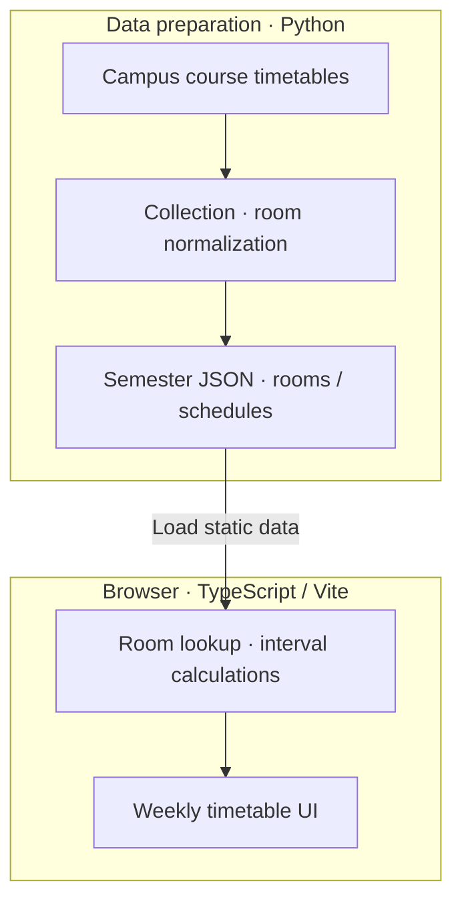

## Background

Finding a building and room in the university timetable was cumbersome. I am developing collection, normalization, lookup, and the web UI myself, with the current focus on readable weekly room schedules.

## System architecture

The browser searches prepared semester data instead of requesting the university server for each lookup.

## My role and design decisions

I handle building/room normalization, schedule generation, time calculations, and responsive screens. Condition-based search is separate from direct room lookup.

I made class start/end and weekly boundaries explicit and separated real current timestamps from manually selected campus times. Tests send the same queries to Python and TypeScript and compare states and ordering.

## Current status

Building/room search and weekly timetable UI are under development and validation. They show registered classes, not actual occupancy, reservations, opening status, or permission to use a room. A public deployment URL and external user evaluation are not yet available.
