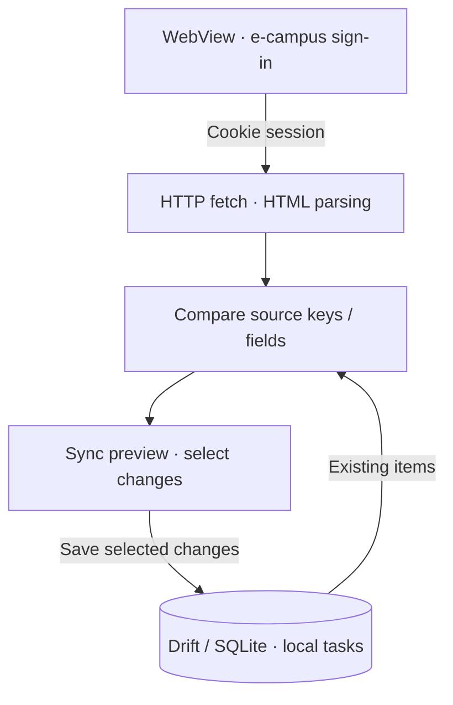

## Overview

KUTODO is a three-person graduation project for managing e-campus assignments and personal tasks together. Without a public API, we need to read HTML after sign-in and decide how source changes should affect local data.

## e-campus sync

The app previews comparisons and lets users select imports instead of immediately overwriting the local list.

## My role and design decisions

I handle WebView sessions, HTTP collection/HTML parsing, source-key comparisons, and the Drift/SQLite data layer. I also connected teammates' UI to actual data and implemented needed task creation/detail screens.

Personal and e-campus tasks share a Task model while keeping source identity and source fields distinct. Source keys identify the same item across syncs; comparing original fields informs what should be applied.

Missing-item handling checks successful collection, errors, and deadline conditions so collection failures are not treated as deletion or completion.

## Current status

The project is ongoing. Parsing, sync, and storage have tests, and an intermediate beta APK was published, but live-account sync and Android notification/widget integration are not fully validated. The overall UI and home widgets include teammates' work, and integration needs further checks.
