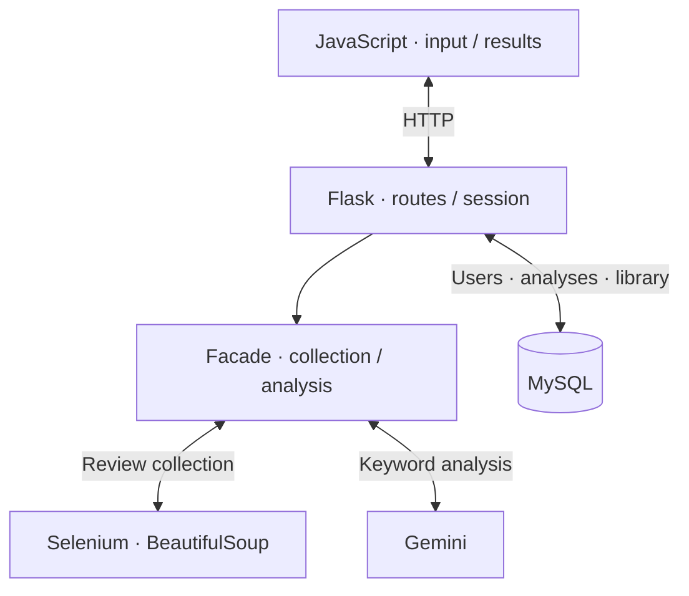

## Overview

This three-person web prototype helps users find relevant pros and cons without reading every review. A Coupang product URL and keywords drive review collection and summarization, and users can save results to a library.

## System architecture

Teammates led crawling and Gemini analysis. I handled the connection from those results to the user interface and storage features.

## My role and design decisions

I built MySQL schemas/CRUD, Flask sessions/routes, the library, and JavaScript UI integration.

Analysis records are separate from each user's saved relationship. Saving records the result and keywords, then connects the library relationship. Deduplication exists at save time; a request-time cache that skips collection and AI calls was not implemented.

I also configured Docker development and attempted NHN Cloud deployment. The crawler remained unstable in headless Linux/NKS, so the final demonstration used a local environment with Chrome's GUI.

## Results and limitations

We demonstrated collection from real product URLs, Gemini output, and the web/library flow in class. External operation, stable cloud deployment, and quantitative summary/recommendation quality evaluation were not completed.
