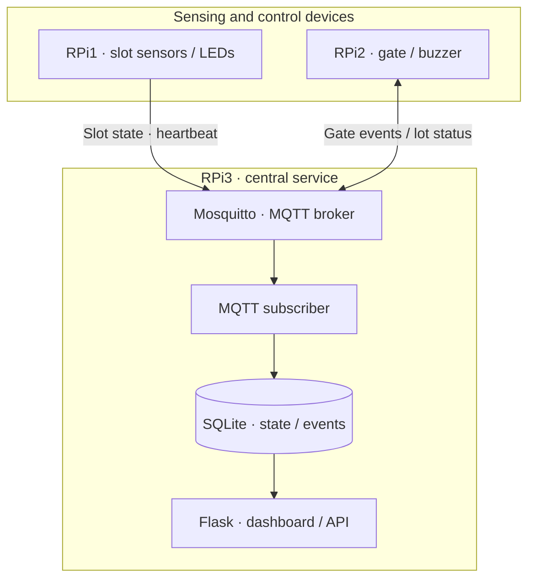

## Overview

Our three-person team split parking sensing, gate control, and central monitoring across three Raspberry Pis. MQTT connected the states and events of a parking model with physical sensors and motors.

## System architecture

Device control was separate from central storage and display, with MQTT topics providing the integration contract.

## My role · RPi3 central service

Each teammate owned one Raspberry Pi. I handled RPi3, the central node.

- Mosquitto broker and MQTT subscriber
- SQLite state/event storage and the Flask dashboard
- Heartbeats and kernel status interfaces for diagnostics
- Wi-Fi AP and local network integration

Heartbeats let us check connectivity separately from parking state. I exposed diagnostics through the dashboard and /dev and /proc interfaces. Teammates implemented the sensing and gate drivers on RPi1/RPi2.

## Results and limitations

We integrated the physical sensors/motors, all three Raspberry Pis, and the browser dashboard for the course demonstration. This model depends on the central RPi3; real-car-park deployment, recovery, and long-term reliability were not validated.
