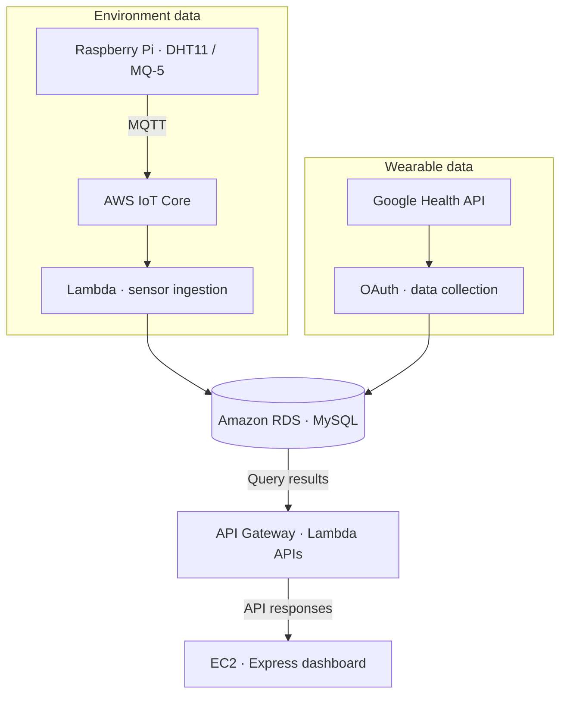

## Overview

ZZZ was a four-person course project connecting room sensors and wearable data. Users could check their environment and activity before bed, then see a sleep score and its supporting information the next morning.

## System architecture

The diagram shows the main data paths in our AWS course demo. We extended the initial Express/SQLite setup with IoT Core and Lambda for sensor ingestion, RDS for storage, API Gateway and Lambda for selected APIs, and Express on EC2 for the web layer. Rules calculate risk and sleep scores; Groq explains those results.

## My role and design decisions

I handled the execution structure, database schemas, Express APIs/dashboard, and team-module integration. Teammates led sensor/wearable collection and the prediction/Groq modules; I connected them to the service and modified the integration.

- Separate collection, storage, processing, and service responsibilities.
- Extend SQLite into user/device-based MySQL/RDS storage.
- Update authentication, collection, storage, and screens for Google Health.
- Calculate scores with rules and use Groq to explain the results.

I used generative AI extensively for code, documentation, and design, integrating and modifying its output for the project.

## Results and limitations

We demonstrated physical sensor collection, AWS IoT ingestion, RDS storage, and the web dashboard in class. This completed an externally accessible AWS course demo; long-term operation and sleep-improvement outcomes were not validated.
