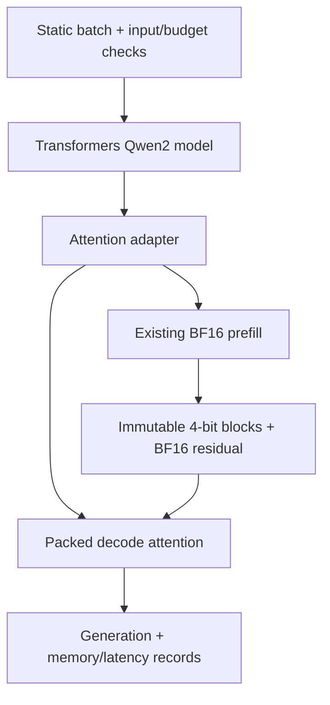

## Overview

KVCompact is a design for single-GPU inference that reads a packed KV-cache directly from attention rather than reconstructing the full historical cache as BF16 tensors each step. Historical 4-bit blocks would remain immutable, with only the needed tiles reconstructed and consumed.

This is a design and experiment plan. There are no kernel, model-integration, baseline-execution, GPU-measurement, or quality-evaluation results yet. Memory savings and speedups are not established outcomes.

## Problem

A small resident cache does not by itself establish low execution cost. Full reconstruction, concatenation, or requantization may introduce temporary buffers and data movement. The plan first profiles a pinned baseline to establish whether those paths actually occur; it does not generalize them to every quantized runtime.

The questions are whether direct reads reduce peak memory and decode cost for the same packed bytes, whether append can avoid rewriting old blocks, and how to separate implementation error from quantization error while evaluating quality, memory, and latency together.

## Planned components

| Component | Plan |
| --- | --- |
| Reference, adapter, harness | Python / PyTorch / Transformers |
| Pack, decode, merge kernels | Triton |
| Environment | Linux, one NVIDIA GPU, pinned CUDA/library versions |
| Reference model | Qwen2.5-7B-Instruct with original BF16 weights |
| Workload boundary | Static batches of at most eight requests; total length at most 32,768 tokens |

These are planned tools, not verified implementation experience. Model loading, projections, RoPE, MLP, and normalization are reused. The owned integration boundary is attention and cache handling.

## Storage and execution contracts

| Choice | Intended contract |
| --- | --- |
| 32-token blocks | Quantize and seal completed historical blocks; do not change them until reset |
| Different K/V axes | Group K over token blocks per channel and V over channel groups per token |
| 4-bit packing | Pack two values per byte and account for scale/offset metadata and alignment |
| BF16 residual | Keep at most 128 recent tokens; seal the oldest 32 before appending when full |
| Capacity reservation | Reserve cache, metadata, residual, and scratch from input/output bounds |
| Tile reconstruction | Avoid full BF16 K/V and full attention-score arrays in decode global memory |

The separate K/V axes are informed by [KIVI](https://proceedings.mlr.press/v235/liu24bz.html), not a reproduction of its 2-bit implementation or measured results.

Prefill reuses existing attention and has length-dependent workspace. Its peak must be measured separately; a bounded decode scratch design is not a whole-execution memory guarantee.

## Trade-offs

- Packed loads can reduce storage and traffic while adding unpack, scale-load, alignment, and register costs.
- Larger residuals may help quality while changing resident memory and flush behavior.
- Split-KV can improve small-batch parallelism while increasing merge, scratch, and launch costs.
- Sequential prefill can lower peak memory but increase later requests' time to first token.
- Weight bandwidth or host overhead can prevent kernel-level gains from improving full-workload time.

## Validation plan

First compare a BF16 adapter with the original model to remove position, mask, and cache-integration errors. Then compare fused computation with an independent oracle reconstructed from the same packed bytes, separating implementation error from quantization error.

| Comparison | Purpose |
| --- | --- |
| Original BF16 cache | Quality and memory reference |
| Transformers HQQ 4-bit cache | Practical comparison with an existing option |
| Full reconstruction of the same packed bytes | Causal comparison of direct reads and fusion at equal storage error |
| vLLM BF16 / supported FP8 | External-engine comparison, without attributing all engine differences to one change |

Format, tails, masking, GQA, EOS, and reset correctness come before memory, latency, throughput, QA, and summarization evaluation. Residual size, split count, and reconstruction are separate ablations. OOM, unsupported, and slower configurations remain in the report.

## Feasibility and current scope

The available RTX 4070 12GB may not fit the reference 7B BF16 model's weights alone. The document's weight-memory estimate is not a measurement. Small-kernel and baseline feasibility come first; CPU offload or quantized weights are not automatically equivalent to the original resident-BF16 comparison.

If the final comparison cannot run locally, it requires a single-GPU environment preserving the same experimental contract. Without that environment, the corresponding validation remains incomplete.

The status remains Planned. CUDA C++ or compiler development, multi-GPU/distributed inference, continuous batching, and production serving are out of scope. Kernel improvements, end-to-end improvements, implementation completion, and goal attainment are separate claims.
