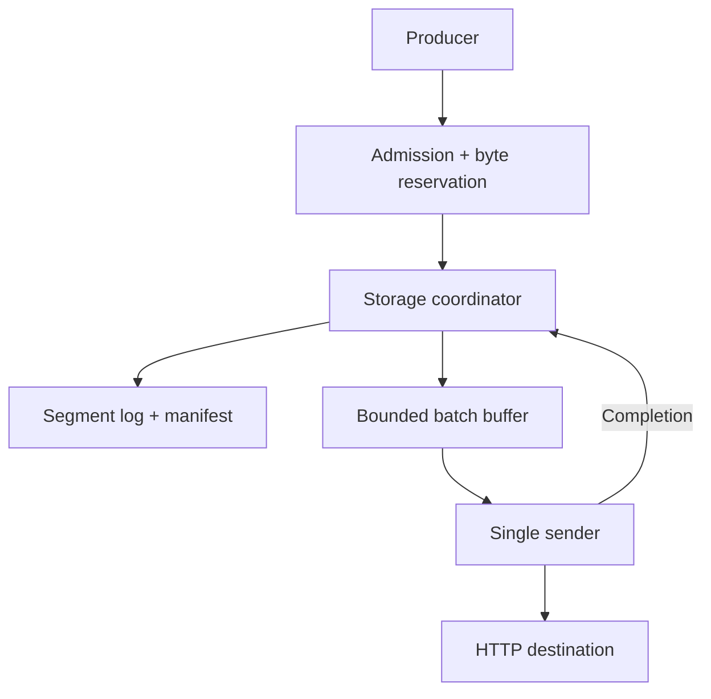

## Overview

Spool is a planned persistent buffer on a single Linux host. It accepts events locally and forwards them to one HTTP destination. The intended contract preserves acknowledged events across destination outages and process restarts, and rejects new input when its storage budget is exhausted rather than silently dropping accepted events.

The inspected code is an initial Go CLI entry point. The following sections describe design and validation plans, not completed storage, recovery, delivery, or performance results.

## Problem

A memory queue is vulnerable to process restarts; unlimited disk buffering can exhaust the host. A successful write alone is insufficient if sync and durable progress publication are ordered incorrectly.

Local durable acceptance is separate from destination completion. Retries after lost responses are allowed to produce duplicates.

## Planned architecture

The target is Go on Linux, using file/directory sync and atomic rename. One coordinator owns sequence allocation, manifests, reservations, and segments. A separate sender avoids holding the storage path while waiting for network responses.

| State | Intended meaning |
| --- | --- |
| Q | A persisted queue UUID |
| D | The last durably accepted sequence and location |
| C | A durably recorded, contiguous destination-completion prefix; C ≤ D |
| B | A logical length/reservation budget for segments, manifests, and temporary files |

### Acknowledgement and reclamation

1. Reserve memory and segment capacity, then append records.
2. Sync the log; write and sync a temporary manifest containing the new D and current C.
3. Rename the manifest and sync its directory before acknowledging acceptance.
4. After destination acknowledgement, persist C through the same coordinator.
5. Reclaim only completed, sealed segments at or below durable C.

These are implementation contracts. Neither successful writes nor destination acknowledgements alone authorize early acknowledgement or deletion.

### Retries and restart

The sender processes one bounded batch at a time, from after C through D. Timeouts, connection loss, and 5xx responses retry the same batch with backoff and jitter. Permanent rejection stops forwarding and exposes the cause rather than dropping the event or skipping C.

Restart validates the manifest and contiguous records after C through D. An uncertain tail beyond D may be removed; checksum failures, missing records, or sequence gaps inside the committed region are designed to fail-stop.

## Decisions and trade-offs

| Choice | Benefit and cost |
| --- | --- |
| One coordinator and sender | Simpler progress and reclamation ordering, with serialization and head-of-line blocking limits |
| Separate durable manifest | Distinguishes committed corruption from uncertain tails, at additional metadata-sync cost |
| Group commit | Shares sync work, but can add waiting and tail latency at low load |
| At-least-once forwarding | Allows recovery from lost responses; destination-side deduplication remains the destination's responsibility |
| Fail-stop on committed corruption | Exposes corruption rather than silently skipping data, at the cost of availability |

Resource limits cover connections, handlers, bodies, commands, and batches in both counts and bytes. Logical file budgets are distinct from RSS, page cache, and physical disk consumption.

## Validation plan

The first slice is **append → sync → manifest publication → durable acknowledgement → kill/restart → external receipt comparison**. Destination completion, durable C, and GC follow only after that path is verified.

- Keep request IDs, payload hashes, and receipts outside the target process; compare against a separate destination ledger without using the product parser as the oracle.
- Inject process termination around persistence boundaries, short writes, ENOSPC, sync/rename failures, and committed-region corruption.
- Check that the oracle detects ack-before-sync, checkpoint-before-send, and delete-before-checkpoint defects.
- Exercise destination outages, lost responses, permanent rejection, capacity exhaustion, and backlog drain after recovery.
- Compare per-record and bounded group commit under equal durability. Record throughput, p50/p95/p99, rejection rates, sync cost, and CPU/heap/lock/I/O profiles.

## Current scope and limitations

There is no implemented core-storage/recovery evidence, crash history, benchmark, or operational result yet. In Progress describes ongoing work, not completed validation.

The scope is one Linux node and one destination, without replication, consensus, multi-node HA, exactly-once effects, or a general database. SIGKILL testing does not establish power-loss durability. The design assumes a filesystem and device that honor successful file/directory sync contracts.
