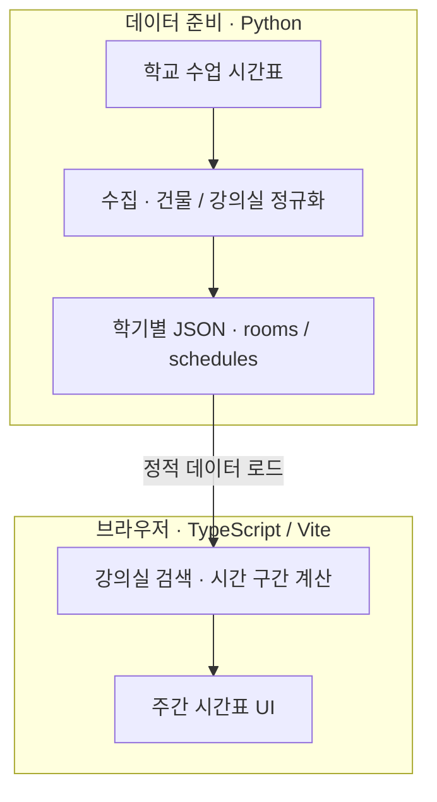

## 개발 배경

복잡한 학교 시간표에서 건물과 강의실의 일정을 매번 찾아야 하는 불편에서 시작했습니다. 혼자 수집·정제·조회 로직과 웹 UI를 개발하고 있으며, 현재는 강의실별 주간 시간표를 쉽게 확인하는 데 초점을 두고 있습니다.

## 시스템 아키텍처

조회할 때마다 학교 서버에 접근하지 않고, 미리 만든 학기별 데이터를 브라우저에서 검색합니다.

## 담당 역할과 주요 설계 결정

건물·강의실 정규화, 일정 데이터 생성, 시간 계산과 반응형 화면을 직접 담당했습니다. 조건에 맞는 공간을 찾는 검색과 특정 강의실의 시간표를 보는 직접 조회를 구분했습니다.

수업의 시작·종료와 주간 경계를 명확히 처리하고, 실제 현재 시각과 사용자가 선택한 캠퍼스 시간을 나눠 계산했습니다. Python과 TypeScript에 같은 질의를 넣어 상태와 정렬 결과를 비교하는 테스트도 구성했습니다.

## 현재 상태

건물·강의실 검색과 주간 시간표 UI를 개발하고 검증하는 단계입니다. 표시하는 것은 등록된 수업 일정이며, 실제 점유·대관·개방 상태나 공간 사용 권한을 보장하지 않습니다. 공개 배포 주소와 외부 사용자 평가는 아직 없습니다.
