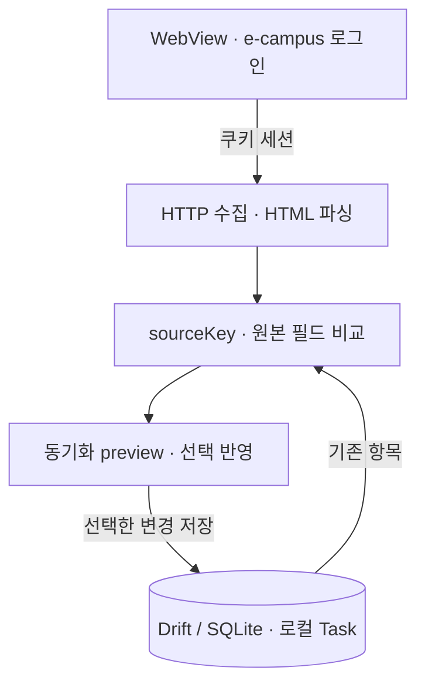

## 프로젝트 소개

e-campus의 과제와 개인 할 일을 한 앱에서 관리하려는 3인 졸업 프로젝트입니다. 공식 공개 API가 없어 로그인 후 HTML을 읽어야 하며, 원본 변경을 로컬 데이터에 어떻게 반영할지가 중요한 문제였습니다.

## e-campus 동기화

가져온 목록을 바로 덮어쓰지 않고, 비교 결과를 preview로 보여준 뒤 사용자가 선택한 항목을 반영합니다.

## 담당 역할과 주요 설계 결정

WebView 세션 처리, HTTP 수집·HTML 파싱, sourceKey 비교와 Drift/SQLite 데이터 계층을 담당했습니다. 팀원이 만든 UI를 실제 데이터에 연결하고 필요한 작업 생성·상세 화면도 구현했습니다.

개인 할 일과 e-campus 할 일은 같은 Task 모델에 저장하되 출처와 원본 필드를 구분했습니다. sourceKey로 같은 항목을 식별하고 원본 변경을 비교해 재동기화 때 반영 대상을 판단합니다.

수집 오류를 항목 삭제나 완료로 오해하지 않도록 누락 항목 처리에는 성공한 수집·오류 여부·마감 조건을 확인하는 방어 정책을 두었습니다.

## 현재 상태

프로젝트는 진행 중입니다. 파싱·동기화·저장 로직에 테스트를 구성하고 중간 beta APK를 공개했지만, 실제 계정의 전체 동기화와 Android 알림·위젯 통합까지 검증을 마친 단계는 아닙니다. UI 전체와 홈 위젯은 팀원 작업이 포함된 범위이며, 통합 상태를 더 점검해야 합니다.
