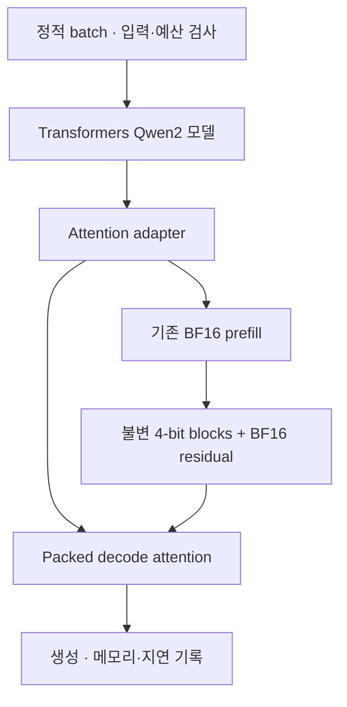

## Overview

긴 문맥을 처리하는 단일 GPU 추론에서, 압축한 KV-cache를 매번 전체 BF16 tensor로 복원하지 않고 attention 커널이 직접 읽는 백엔드를 설계했습니다. 과거 블록을 불변의 4-bit 형식으로 유지하고 필요한 타일만 복원해 소비하는 경로가 핵심입니다.

현재는 설계·실험 계획 단계입니다. 커널 코드, 모델 통합, baseline 실행, GPU 실측과 품질 평가 결과는 아직 없습니다. 메모리 절감이나 속도 향상을 달성한 프로젝트로 표시하지 않습니다.

## Problem

저정밀 KV-cache의 상주 저장량이 작아도, 실행 중 전체 cache 복원·연결·재양자화가 발생하면 임시 메모리와 데이터 이동 비용이 생길 수 있습니다. 설계 문서는 이 경로가 고정한 baseline에서 실제로 발생하는지부터 profiling으로 확인하도록 정리했습니다. 모든 양자화 런타임이 같은 병목을 가진다고 가정하지 않습니다.

검증하려는 질문은 다음과 같습니다.

- 같은 packed bytes를 사용해도, 전체 복원을 없애면 실제 peak memory와 decode 비용이 줄어드는가?
- 새 토큰을 추가할 때 과거 블록을 다시 복사하거나 양자화하지 않을 수 있는가?
- 압축 오차와 구현 오류를 구분하면서 품질·메모리·지연을 함께 비교할 수 있는가?

## 계획한 구성

| 구분 | 계획 |
| --- | --- |
| Reference·adapter·실험기 | Python / PyTorch / Transformers |
| Pack·decode·merge 커널 | Triton |
| 실행 환경 | Linux, NVIDIA GPU 한 장, 고정한 CUDA·라이브러리 버전 |
| 기준 모델 | Qwen2.5-7B-Instruct, 원본 BF16 weight |
| 처리 범위 | 시작 시 구성한 정적 batch, 최대 8개 요청·총 길이 32,768 tokens |

위 기술은 구현 계획이며 실제 사용·검증을 마친 기술 목록이 아닙니다. 모델 로딩, projection, RoPE, MLP와 norm은 기존 모델을 재사용하고 attention/cache 경계만 좁게 연결합니다.

## 저장 형식과 실행 계약

| 선택 | 설계 의도 |
| --- | --- |
| 32-token 블록 | 완성된 과거 블록만 양자화·봉인하고 reset 전까지 변경하지 않음 |
| 서로 다른 K/V 축 | K는 channel별 token 블록, V는 token별 channel group으로 구성 |
| 4-bit packing | 값 두 개를 한 byte에 넣고 group별 scale·offset과 정렬 비용을 함께 계산 |
| BF16 residual | 최근 토큰은 최대 128개 유지하고, 가득 차면 오래된 32개를 먼저 봉인 |
| 사전 capacity 예약 | 입력·최대 출력 길이에 따라 cache·metadata·residual·scratch를 예약 |
| 타일 단위 복원 | decode에서 전체 BF16 K/V나 전체 attention-score 배열을 global memory에 만들지 않는 것을 목표로 함 |

K/V 양자화 축 선택은 [KIVI](https://proceedings.mlr.press/v235/liu24bz.html)를 참고합니다. 2-bit 구현이나 결과를 이 프로젝트의 성과로 쓰지 않습니다.

Prefill은 기존 attention을 재사용하지만 길이에 따른 workspace가 필요합니다. decode의 작은 scratch 계약을 전체 실행 메모리 보장으로 확대하지 않고, prefill과 decode peak를 따로 측정할 계획입니다.

## 주요 Trade-offs

- Packed load는 저장·전송량을 줄일 수 있지만 unpack, scale load, 정렬과 register 비용을 추가합니다.
- 큰 residual은 품질에 유리할 수 있지만 상주 메모리와 flush 특성이 달라집니다.
- Split-KV는 작은 batch의 병렬성을 높일 수 있지만 merge·scratch·launch 비용이 늘어납니다.
- 요청별 순차 prefill은 peak를 낮추는 대신 뒤 요청의 첫 토큰 대기시간을 늘릴 수 있습니다.
- Weight bandwidth나 host 실행이 지배적이면 attention 개선이 전체 작업 속도로 이어지지 않을 수 있습니다.

## 검증 계획

먼저 BF16 adapter와 원본 모델을 비교해 position·mask·cache 연결 오류를 제거합니다. 이후 같은 packed bytes를 복원한 독립 oracle와 fused 연산을 비교해 구현 오류와 양자화 오차를 분리합니다.

| 비교 | 목적 |
| --- | --- |
| 원본 BF16 cache | 품질과 메모리의 기준 |
| Transformers HQQ 4-bit cache | 기존 선택지와의 실용 비교 |
| 같은 packed bytes의 전체 복원 경로 | 저장 오차를 같게 둔 직접 읽기·fusion의 인과 비교 |
| vLLM BF16 / 지원되는 FP8 | 별도 엔진과의 실용 비교. 엔진 차이를 하나의 변경 효과로 해석하지 않음 |

형식·tail·mask·GQA·EOS·reset correctness를 먼저 확인하고, 통과한 구현에서만 메모리·지연·처리량·QA·요약 품질을 평가할 계획입니다. Residual·split 수·전체 복원 여부는 별도 ablation으로 비교합니다. OOM·미지원·열세 조건도 결과에서 제외하지 않습니다.

## 실행 환경 제약과 현재 범위

보유 RTX 4070 12GB에서는 기준 7B BF16 모델의 가중치만으로도 용량이 부족할 수 있습니다. 문서의 가중치 메모리 추정은 실측값이 아닙니다. 작은 커널과 baseline 실행 가능성을 먼저 확인하고, CPU offload나 weight quantization 결과를 원래 BF16 resident baseline과 동등한 것으로 취급하지 않습니다.

최종 비교가 로컬에서 성립하지 않으면 같은 실험 계약을 유지할 수 있는 단일 GPU 환경이 필요합니다. 환경을 확보하지 못하면 해당 검증은 미완료로 남깁니다.

현재 상태는 Planned입니다. CUDA C++·compiler 개발, multi-GPU·분산 추론, continuous batching과 production serving은 범위 밖입니다. 커널 단독 개선과 전체 생성 작업의 개선, 구현 완료와 목표 달성도 각각 구분합니다.
