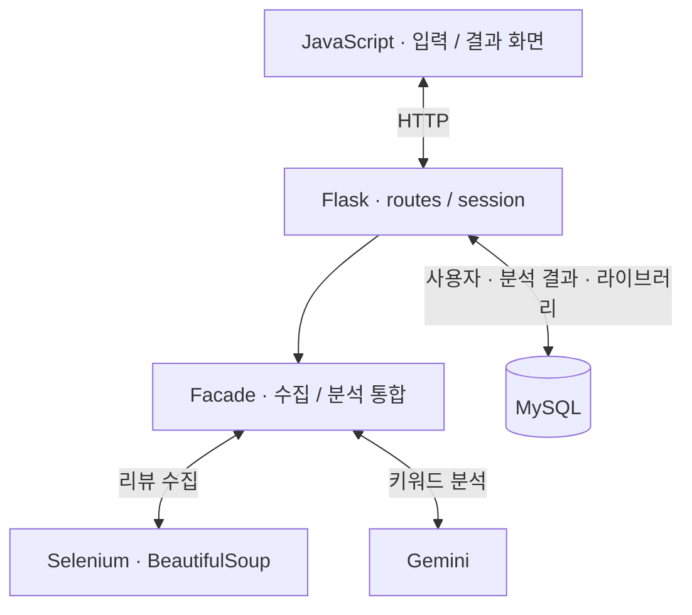

## 프로젝트 소개

상품 리뷰를 모두 읽기 어려울 때 관심 있는 장단점을 빠르게 확인하도록 만든 3인 팀 웹 프로토타입입니다. 쿠팡 상품 URL과 키워드를 입력하면 리뷰를 수집·요약하고, 사용자가 결과를 라이브러리에 저장할 수 있습니다.

## 시스템 아키텍처

크롤러와 Gemini 분석은 팀원이 주로 개발했습니다. 저는 결과가 사용자 화면과 저장 기능으로 이어지는 부분을 맡았습니다.

## 담당 역할과 주요 설계 결정

MySQL 스키마·CRUD, Flask 세션·라우트, 라이브러리와 JavaScript 화면 통합을 담당했습니다.

분석 결과 자체와 사용자별 저장 관계를 분리했습니다. 사용자가 저장을 선택하면 결과와 키워드를 기록하고 라이브러리 관계를 연결합니다. 저장 단계의 중복 처리는 있지만, 분석 요청 전에 수집·AI 호출을 생략하는 캐시는 구현하지 않았습니다.

Docker 개발환경과 NHN Cloud 배포도 시도했습니다. 하지만 GUI 없는 Linux/NKS에서 크롤러를 안정화하지 못해 최종 시연은 Chrome GUI가 동작하는 로컬 환경으로 정했습니다.

## 결과 및 한계

실제 상품 URL의 리뷰 수집, Gemini 결과 생성과 웹·라이브러리 흐름을 수업에서 시연했습니다. 외부 사용자 운영, 안정적인 클라우드 배포와 요약·추천 품질의 정량 평가까지 완료한 프로젝트는 아닙니다.
