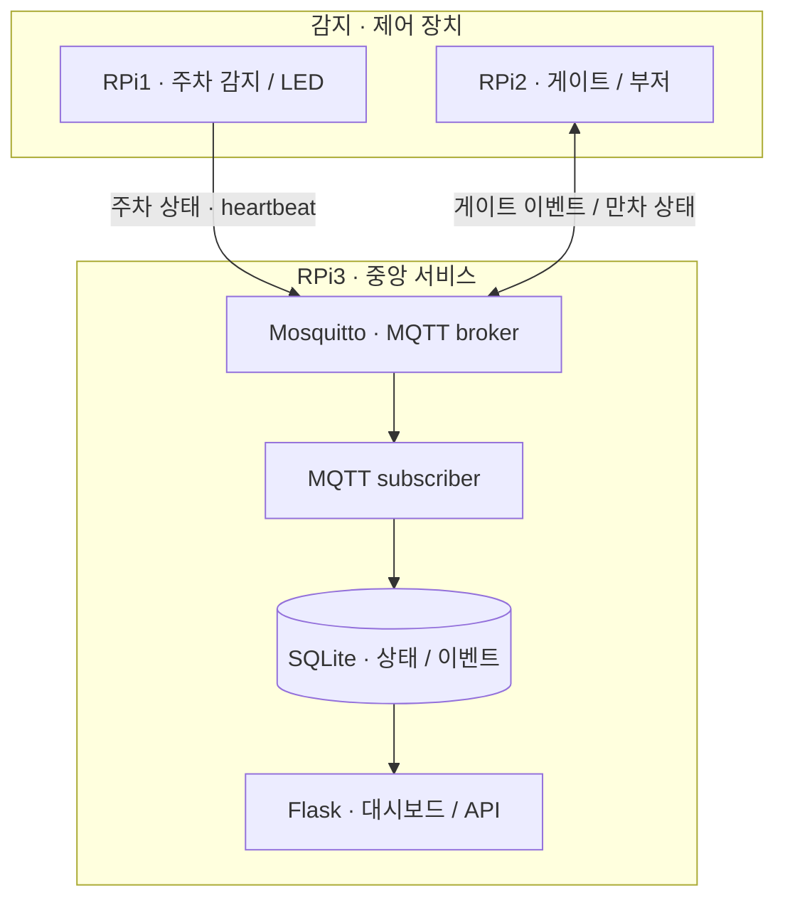

## 프로젝트 소개

Raspberry Pi 세 대로 주차 감지, 게이트 제어와 중앙 모니터링을 나눈 3인 팀 프로젝트입니다. 센서·모터가 달린 주차장 모형의 상태와 이벤트를 MQTT로 연결했습니다.

## 시스템 아키텍처

장치 제어와 중앙 저장·표시를 분리하고, MQTT topic을 통합 기준으로 사용했습니다.

## 담당 역할 · RPi3 중앙 서비스

팀원마다 Raspberry Pi 한 대씩을 맡았고, 저는 중앙 노드 RPi3를 담당했습니다.

- Mosquitto broker와 MQTT subscriber
- 상태·이벤트의 SQLite 저장과 Flask 대시보드
- heartbeat와 커널 상태 인터페이스를 이용한 장치 진단
- Wi-Fi AP와 로컬 네트워크 통합

주차 상태와 장치의 연결 상태를 따로 확인할 수 있도록 heartbeat를 받았습니다. 진단 정보는 대시보드와 /dev·/proc 인터페이스로 연결했습니다. RPi1·RPi2의 센서·게이트 드라이버는 팀원이 구현했습니다.

## 결과 및 한계

실제 센서·모터, 세 Raspberry Pi와 브라우저 대시보드를 통합해 수업 시연을 마쳤습니다. 중앙 RPi3에 의존하는 주차장 모형이며, 실제 주차장 배포나 장애 복구·장기 안정성까지 검증한 구조는 아닙니다.
