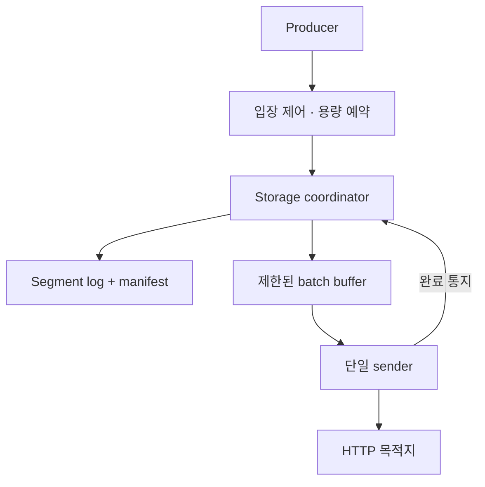

## Overview

단일 Linux 호스트에서 이벤트를 받아 로컬에 영속 저장한 뒤, 하나의 HTTP 목적지로 전달하는 버퍼를 설계하고 있습니다. 목적지가 내려가거나 프로세스가 재시작돼도 이미 수신을 확인한 이벤트를 보존하고, 저장 예산이 소진되면 기존 이벤트를 버리는 대신 새 입력을 거절하는 것이 목표입니다.

현재 확인한 코드는 Go CLI 진입점 골격입니다. 아래 내용은 설계와 검증 계획이며, 저장·복구·전송 구현이나 성능 측정을 완료한 결과가 아닙니다.

## Problem

메모리 queue만 쓰면 재시작에 취약하고, 제한 없이 디스크에 쌓으면 호스트의 공간을 소진합니다. 파일 쓰기 성공 직후 응답하더라도 sync와 진행 위치 게시의 순서가 틀리면 성공 처리한 데이터가 복구되지 않을 수 있습니다.

로컬 영속 수신과 목적지 처리 완료를 분리하고, 응답 유실에 따른 중복을 전달 계약에 포함합니다.

## 설계한 구조

Go로 구현하고 Linux의 파일·디렉터리 sync와 atomic rename 계약을 사용하는 범위입니다. coordinator가 sequence, manifest, 공간 예약과 segment 목록을 소유하고, 네트워크 응답을 기다리는 동안 저장 경로를 점유하지 않도록 sender를 분리합니다.

| 상태 | 설계상 의미 |
| --- | --- |
| Q | 영속화한 queue UUID |
| D | 로컬 영속 수신을 확정한 최종 sequence와 위치 |
| C | 목적지 성공 응답 후 영속화한 연속 완료 구간. 항상 C ≤ D |
| B | segment·manifest·임시 파일 길이와 예약에 대한 논리 예산 |

### 수신 확인과 회수 순서

1. 메모리·segment 예산을 예약하고 record를 append합니다.
2. 로그를 sync한 뒤, 새 D와 현재 C를 담은 임시 manifest를 쓰고 sync합니다.
3. manifest를 rename하고 디렉터리까지 sync한 뒤 성공 응답합니다.
4. 목적지의 batch 성공 응답을 받으면 C를 같은 coordinator에서 영속화합니다.
5. durable C 이하의 완료된 sealed segment만 회수합니다.

이 순서는 구현할 계약입니다. 쓰기 완료를 영속 완료로 간주하거나, 목적지 확인만 받고 C 저장 전에 파일을 삭제하지 않도록 설계했습니다.

### 재전송과 재시작

Sender는 C 이후 D까지 제한된 batch를 하나씩 보냅니다. Timeout·연결 종료·5xx에는 같은 batch를 backoff·jitter와 함께 재시도하고, 목적지의 영구 거절에는 전달을 멈춰 원인을 노출합니다. 해당 이벤트를 버리거나 C를 건너뛰지 않습니다.

재시작 시 manifest와 C 이후 D까지의 연속 record를 검증합니다. D 밖의 불확정 tail은 정리할 수 있지만, 확정 구간의 checksum 오류·누락·순서 단절은 fail-stop으로 처리하는 설계입니다.

## 주요 선택과 Trade-offs

| 선택 | 이유와 비용 |
| --- | --- |
| 단일 coordinator·sender | 진행 위치와 회수 순서를 단순화하지만 직렬 병목과 head-of-line blocking이 생길 수 있음 |
| 별도 durable manifest | 확정 구간 손상과 미확정 tail을 구분하는 대신 metadata sync 비용이 추가됨 |
| Group commit | 동일 내구성에서 sync 비용을 나누되 저부하 대기와 tail latency를 함께 확인해야 함 |
| At-least-once 전달 | 응답 유실 후 재시도를 허용하며, 중복 효과 제거는 목적지 책임 |
| 손상 시 fail-stop | 확정 구간의 손상을 자동으로 건너뛰어 유실을 숨기지 않는 대신 서비스가 중단될 수 있음 |

메모리 제어도 channel 길이만 제한하는 것으로 끝내지 않습니다. 연결·handler·body·명령·batch의 개수와 bytes를 함께 제한하고, 논리 파일 예산과 실제 RSS·page cache·디스크 사용량은 구분해 확인할 계획입니다.

## 검증 계획

첫 검증 경로는 **append → sync → manifest 게시 → durable ack → kill/restart → 외부 receipt 대조**입니다. 이 경로를 확인한 뒤 목적지 확인·durable C·GC로 확장합니다.

- 요청 ID·payload hash·receipt를 대상 프로세스 밖에 기록하고, 목적지의 별도 ledger와 비교합니다. 정답 생성에 제품의 로그 parser를 재사용하지 않습니다.
- 영속화 경계의 프로세스 종료, short write, ENOSPC, sync/rename 오류, 확정 구간 checksum 손상을 주입합니다.
- ack-before-sync, checkpoint-before-send, delete-before-checkpoint 결함을 oracle이 검출하는지도 확인합니다.
- 목적지 중단·응답 유실·영구 거절·공간 포화 후 보존, 입력 거절, 정상화 후 backlog 감소를 확인합니다.
- record별 durable commit과 bounded group commit을 **같은 내구성 조건**에서 비교합니다. 처리량뿐 아니라 p50/p95/p99, 거절률, sync 비용과 CPU·heap·lock·I/O를 기록합니다.

## 현재 범위와 한계

핵심 저장·복구 경로의 구현 증거, crash history, benchmark와 운영 결과는 아직 없습니다. 진행 상태는 In Progress로 유지하며 검증 완료로 표시하지 않습니다.

대상은 단일 Linux 노드·단일 목적지입니다. 복제·합의·다중 노드 HA·exactly-once·범용 DB는 포함하지 않습니다. SIGKILL 검증은 실제 전원 장애 보장이 아니며, 파일·디렉터리 sync를 지키는 파일시스템과 장치 계약을 가정합니다.
