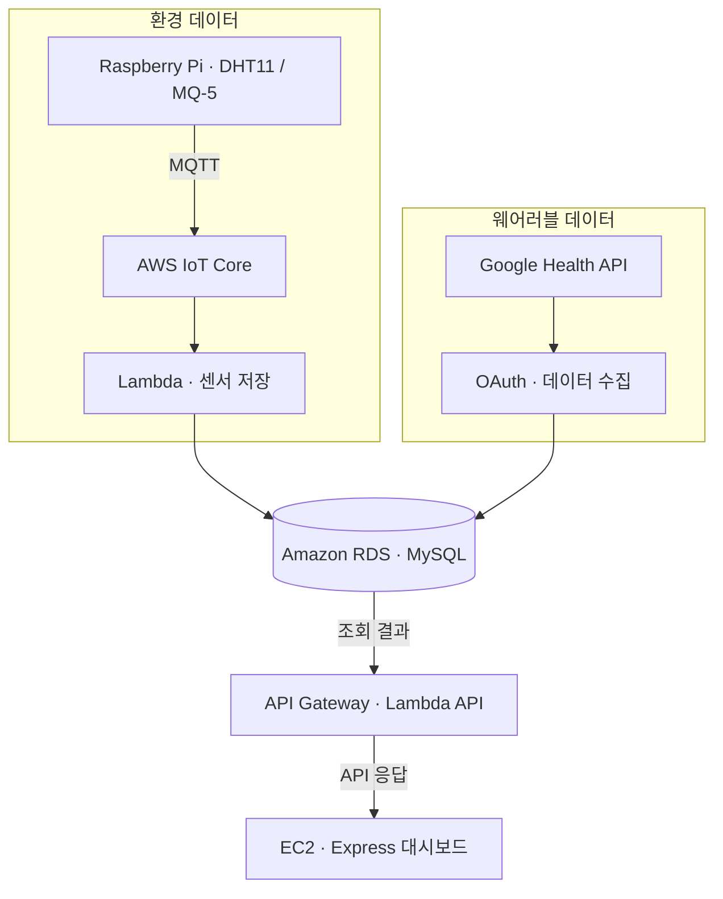

## 프로젝트 소개

ZZZ는 환경 센서와 웨어러블 데이터를 연결한 4인 수업 프로젝트입니다. 취침 전에는 방의 환경과 활동 상태를, 기상 후에는 수면 점수와 그 근거를 확인할 수 있도록 만들었습니다.

## 시스템 아키텍처

위 구조는 AWS 수업 시연 단계의 주요 데이터 경로입니다. 초기 Express·SQLite 구성에서 센서 유입은 IoT Core·Lambda, 저장은 RDS, 일부 API는 API Gateway·Lambda, 웹은 EC2의 Express로 나눠 확장했습니다. 위험도와 수면 점수는 규칙으로 계산하고, Groq는 그 결과를 설명하는 데 사용했습니다.

## 담당 역할과 주요 설계 결정

전체 실행 구조, DB 스키마, Express API·대시보드와 팀 모듈 통합을 담당했습니다. 센서·웨어러블 수집기와 prediction·Groq 모듈은 팀원이 주로 개발했고, 저는 서비스에 연결하고 필요한 부분을 수정했습니다.

- 수집·저장·처리·서비스의 책임을 분리했습니다.
- SQLite를 사용자·기기 기준의 MySQL/RDS 구조로 확장했습니다.
- Google Health 전환에 맞춰 인증부터 수집·저장·화면 연결을 수정했습니다.
- 점수는 규칙으로 계산하고, Groq는 계산 결과를 설명하는 역할로 연결했습니다.

코드·문서·설계에는 생성형 AI를 폭넓게 활용하고, 결과를 프로젝트 구조에 맞게 통합·수정했습니다.

## 결과 및 한계

실제 센서 수집부터 AWS IoT 유입, RDS 저장과 웹 대시보드까지 연결해 수업에서 시연했습니다. 외부에서 접속 가능한 AWS 수업용 데모를 완료한 범위이며, 장기 운영이나 수면 개선 효과를 검증한 서비스는 아닙니다.
